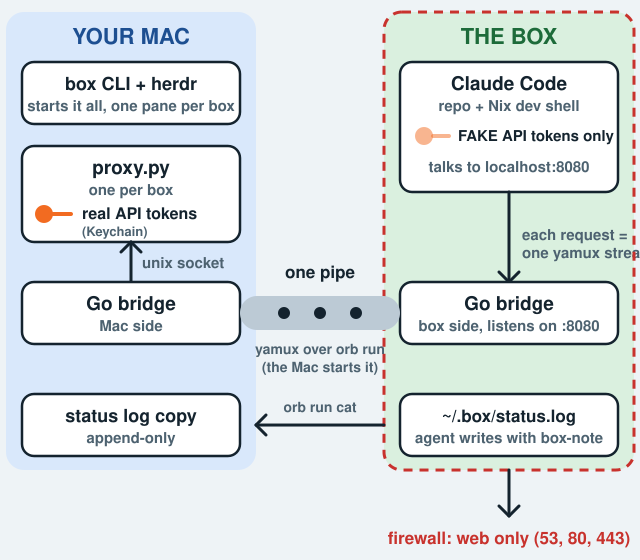

# agent-boxes

Run an AI coding agent on your Mac without handing it your keys or your machine.

## What is this?

Coding agents like Claude Code work best when they can run commands freely, but that is risky on your own computer: they could read your files, reach your network, or leak your API tokens. agent-boxes gives each agent its own sealed Linux box. The agent can do anything inside the box, but it cannot touch your Mac, and it never sees a real token.

One command sets it up:

```
box new myapp
```

That creates a GitHub repo for the project, builds an isolated box, and opens a terminal pane (in herdr, a terminal multiplexer for coding agents) with Claude Code running inside the box. You type the task. The agent writes the code and opens a pull request as a separate bot account. You review the PR on GitHub and merge it yourself.

If something goes wrong, `box reset myapp --to <commit|pr/N|status/N>` rebuilds the box at an earlier point.

## How it works



1. **The box** is an isolated Linux machine (OrbStack). Claude Code runs there with fake tokens only. A firewall lets it out on ports 53, 80 and 443 and nowhere else (no LAN, no Mac).
2. **The proxy** runs on your Mac, one per box. It swaps the fake token for the real one, which lives only in your Keychain, and refuses requests that are not allowed (other repos, merging, GraphQL).
3. **The bridge** is the single pipe between the two. Nothing else connects the box to the Mac.
4. **GitHub** enforces the last rule: `main` is locked and needs your approval, so only you can merge.

Compared with plain herdr plus Claude Code, you get four extra things: an isolated box, real tokens that never enter it, a locked `main`, and reset to a saved point.

## Quick start

Apple Silicon Macs only.

1. Install [OrbStack](https://orbstack.dev) and herdr, then `brew install go jq gh` and `gh auth login` as the repo owner.
2. Get two tokens: `claude setup-token` (Claude), and a classic token with scope `repo` for the bot account (a second GitHub account that has accepted collaborator invites).
3. `git clone` this repo, put `bin/box` on your PATH, and run `box setup`. It asks for your GitHub login, the bot's login and your git identity, saves them in `~/.config/agent-boxes/config`, asks for each missing token (stored only in the Keychain), adds the `Host orb` ssh entry, and builds `box-base` (a few minutes). Rerunning it is safe; it only fills in what is missing.
4. `box new myapp`, then type your task in the pane that opens.

## Commands

| Command | Does |
|---|---|
| `box new NAME [--repo owner/name \| --fork owner/name]` | Create the repo, fork one into your account, or attach one of yours; lock main, make the box, start its proxy and bridge, open the herdr pane |
| `box status [NAME] [--history]` | One row per box: state, last task, commit, PR link, time. `--history` numbers every entry (`status/N`) |
| `box reset NAME --to <commit\|pr/N\|status/N>` | Delete the box and rebuild it at that commit. Packages come back through `flake.lock` |
| `box rm NAME` | Delete the box, its proxy and bridge. The repo and status history stay |
| `box panic` | Stop every box, bridge and proxy now |
| `box ls` | List machines |
| `box token NAME` | Add or replace a real token in the Keychain (`claude` and `github` are the built-in names; the Keychain item is `agentbox-NAME`) |
| `box setup` | One-time setup on a new Mac |
| `box base` | Rebuild `box-base`, the bridge binaries, and apply `box/claude` |

The proxy only injects the two built-in tokens for now; a new service also needs a route in `proxy/proxy.py`.

## Security

### What protects what

| Threat | Control |
|---|---|
| Real token leaks from a box | Boxes hold fake tokens; the per-box proxy swaps in the real one. Verified: no real token in a box, argv or log |
| Agent writes to another repo or merges | Proxy: own repo only; REST allow-list (read, open or edit a PR, comment); GraphQL refused. GitHub: `main` ruleset with no bypass and 1 required approval, so only you merge |
| Box reaches your Mac or home network | OrbStack `--isolated` plus a root-owned nftables file: LAN, private ranges, multicast, IPv6 rejected; only 53, 80, 443 out. No sudo |
| Agent edits Claude's settings | `/etc/claude-code/managed-settings.json` is root-owned |
| Secrets pushed to GitHub | GitHub secret scanning and push protection on every repo `box new` makes |
| Install scripts and brand-new packages | A request in the box `CLAUDE.md` (no install scripts, nothing newer than 7 days). Not enforced |

### Accepted gaps

- With 80/443 open the agent can still send repo code anywhere. The design protects **tokens, not data**. The repos are public anyway.
- An injected agent could misuse your home internet address over 80/443 (for example hammering a website).
- "If anything is unclear or blocked, stop and ask" and the 7-day package rule in the box `CLAUDE.md` are requests, not controls.
- `--fork` and `--repo` apply the same `protect-main` ruleset, push protection and bot invite as a new repo (skipped if already there). Forks of other people's repos start from their default branch and their PRs target your fork, not upstream.
- `box reset` rewinds the code, not the status history. The history is append-only on the Mac, so after a reset `box status` still shows the entries from before it (for example `done` at the old commit) until the agent writes a new one.
- Pro usage is the real cap on parallel boxes.
- With the Mac asleep or the proxy down, Claude shows its own error and stops after about 3 minutes.
- Claude shows "Remote managed settings failed to load (401)" in every pane: its policy call goes direct with a fake token. Harmless.

## Troubleshooting

- **Agent is stuck or asked something:** answer in its pane. "dangerous rm" questions in bypass mode are normal.
- **Suspect a box:** `box panic`, then `box rm NAME`. To cut GitHub access, revoke the bot's classic token and re-save it in Keychain (`agentbox-github`).
- **`box new` failed:** it rolls back the box, jobs and a repo it created. `BOX_KEEP=1 box new ...` keeps them for debugging. Proxy and bridge logs are in `~/.config/agent-boxes/logs/`.
- **Claude can't connect:** is the Mac awake and the bridge up? From this repository's root, run `BRIDGE_DIR=~/.config/agent-boxes/logs build/agentbox-bridge status`.
- **Proxy blocks something:** one JSON line per block in `logs/NAME.proxy.log`; `rule` is `not-own-repo`, `rest-not-allowed`, `bad-token` or `gh-api-not-repos`.

## Customizing

- **Plugins or Claude settings:** edit `box/claude/`, run `box base`; new boxes pick it up. Root-owned settings: `box/managed-settings.json`.
- **Firewall:** edit `box/firewall.nft`. If a real tool needs another port, add that port; don't remove the rule.
- **Check isolation by hand:** from a box (`orb -m NAME <cmd>`), `curl -m 3 http://192.168.1.1` and `curl -m 3 http://host.orb.internal` must fail, `curl -m 5 https://github.com` must work, `sudo -n true` must fail.

## For contributors

### Layout

- `bin/box` the CLI. `box/sandbox` makes boxes; `box/setup.sh` builds the base; `box/firewall.nft`, `box/managed-settings.json`, `box/box-note` are installed into every box; `box/claude/` is the agent's `~/.claude` (CLAUDE.md, plugins).
- `proxy/proxy.py` the per-box proxy (Python stdlib, one file). `bridge/` the Go bridge (frozen; built into `build/` by `box base`).
- Mac state in `~/.config/agent-boxes/`: `config`, `box-repos/` (box to repo), `run/` (sockets, mode 700), `logs/` (JSON lines from the proxy; no header values), `status/` (append-only copies of each box's status log).
- launchd jobs `dev.agent-boxes.<box>-proxy` and `-bridge` in `~/Library/LaunchAgents`, written by `box new`, removed by `box rm` and `box panic`.
- The earlier GitHub App flow is on branch `app-token`; the original design notes are in git history (`MVP-HANDOFF.md`, `PLAYBOOK.md`).

### Rules to keep

- Real tokens never enter a box, a log, argv or a file other than Keychain.
- No path from a box to the Mac except the bridge socket and the Mac-started `orb run`.
- Keep the proxy small and in one file; don't change the bridge unless a test fails.

### Stretch goals (not built)

DNS tunnelling, narrowing the DHCP rule (`udp dport 67`) to the box gateway, a size cap on proxy request bodies, a marketplace allow-list for plugins, fine-grained GitHub tokens in an org, a `gh pr create` wrapper, hooks that write status lines, Mac notifications, rotating fake tokens.
